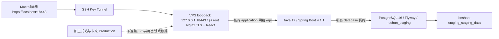
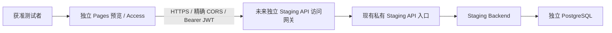

# Staging 部署准备

**准备完成不等于部署成功。本文命令均为获得所有者批准后的未来操作。**
本轮不连接 VPS、不改 DNS/Cloudflare、不启动服务器数据库、不初始化正式 ghost。
业务代码、注册 USER 默认值、管理员权限、创始人初始化及 Analytics 配置均不改变。
此前所有者报告 `5710a891cd1be771e1a26f15ec5fc7fb622aeaed` 的 VPS 隔离测试
PASS、容器停止 true、退出码 0；这不是本轮 Staging 配置的部署结果。

## 架构比较与推荐

| 项目 | A：Cloudflare Pages + VPS API/PG | B：VPS Nginx + React/API/PG |
| --- | --- | --- |
| 成本 | 可用 Pages Free，沿用 VPS；额度、Access、备份存储费用另行批准 | 不新增 VPS，静态文件增加少量内存/磁盘与 VPS 流量 |
| 性能 | 静态资源由边缘网络分发，API 仍受单核 VPS 限制 | 资源与 API 共用 VPS，地区延迟与带宽需实测 |
| 安全 | 前后端分离，精确 CORS；Pages 访问保护不能代替 API 保护 | 同源 JWT，无跨域凭据；Nginx/证书需要维护 |
| 维护 | 前端托管/版本回滚方便，但跨平台配置较多 | 一个部署包，运维、补丁、TLS 与回滚自己负责 |
| Analytics | 保留代码；不要开启 Pages 自动注入造成重复统计 | 保留代码；本地/测试域名不会加载 beacon |
| DNS/HTTPS | pages.dev 可先测试；公开 API 的独立 HTTPS/访问网关另行批准 | 私有 SSH Tunnel + localhost TLS 无需 DNS；公开域名另行批准 |
| API | 对外方案需 `VITE_API_BASE_URL=https://staging-api.<approved-domain>/api` | 私有方案构建 `/api`，Nginx 保留 /api 路径代理 |
| 旧站影响 | 使用全新 Pages 项目，不绑定现有 heshan.net | 全新 Compose 项目、端口、内网与 Volume，不接管 80/443 |

推荐 **A 作为早期社区后续对外架构**，减轻 2GB VPS 的静态资源与前端运维负担。
但第一次 Staging 推荐使用已准备的 **B 私有同源方案**，先在无 DNS 改动、无公网
入口的条件下验证业务；再单独批准 A 的 Pages/API 网关联调，不能认为 B 已验证了 A。
Pages 的 Free 配额、静态边缘分发与 preview 访问机制见
[官方限制](https://developers.cloudflare.com/pages/platform/limits/)和
[预览访问保护](https://developers.cloudflare.com/pages/configuration/preview-deployments/)。
没有创建云资源、订阅或承诺零费用。国内网络体验仍需实测。





## 隔离与资源

配置在 `deploy/staging/`，脚本固定项目 `heshan-staging`、数据库 `heshan_staging`、
角色 `heshan_staging_app`、Volume `heshan-staging_staging_data`。与生产的 heshan 项目、
172.30.10.0/24 和 postgres_data 无关。Staging application 使用 172.30.20.0/24，
仅信任固定代理 172.30.20.10/32；两个网络均 internal。不要修改项目名复用生产资源。
PostgreSQL 与后端均不发布端口；仅 Nginx 绑定 IPv4 loopback 18443。

DB 384 MiB + 后端 768 MiB + Nginx 64 MiB = **1216 MiB 上限**，CPU 配额合计 1.05 核
（不是单核上会同时兑现的保证）；JVM heap 320 MiB、metaspace 128 MiB、PG buffers 64 MiB。
约 2GB 机器需为系统/Docker/缓存留下余量。Swap 是兜底，不是容量扩展。
预估镜像/版本包 1-3 GiB，初期测试数据/日志/备份另预留 1-2 GiB，不代表长期容量承诺。
部署前 artifact 文件系统和 Docker data-root 均至少剩余 4 GiB、MemAvailable 至少 1300 MiB。
**通常不应在该 VPS 同时运行两套常驻 Staging + Production**。资源不足就退出，不能停其他服务。

脚本检查已运行容器、镜像架构/标签、Volume 所属、Docker 子网重叠和端口冲突。
主机 VPN/路由范围还需通过下方只读命令审查，发现冲突应重新审核方案，不擅自改网络。
运行中的相同 Staging 也不隐式重建；先备份并显式停止它，再重新 preflight。
没有全局清理、down 或删除 Volume 的命令。所有镜像 pull_policy=never；先批准镜像准备。

## 环境变量

只使用独立、所有者为执行用户、mode 0600 的绝对路径 staging.env。
脚本不 source 文件，也不继承外部 STAGING_* 覆盖；以下仅名称与占位符：

| 名称 | 示例占位符 |
| --- | --- |
| STAGING_BACKEND_REVISION | `<full-git-sha>` |
| STAGING_BACKEND_IMAGE | `heshan-backend:<same-full-git-sha>` |
| STAGING_FRONTEND_REVISION | `<same-full-git-sha>` |
| STAGING_STATIC_DIR | `/srv/heshan-staging/releases/<sha>/frontend` |
| STAGING_TLS_DIR | `/etc/heshan-staging/tls` |
| STAGING_DB_NAME | `heshan_staging` |
| STAGING_DB_USER | `heshan_staging_app` |
| STAGING_DB_PASSWORD | `<fresh-random-hex>` |
| STAGING_DB_ADMIN_PASSWORD | `<different-fresh-random-hex>` |
| STAGING_JWT_SECRET | `<another-fresh-random-hex>` |
| STAGING_CORS_ALLOWED_ORIGINS | `https://localhost:18443` |

init-env 为每个密钥生成独立随机值，拒绝覆盖旧文件。不要复制生产文件或查询生产密钥。
无法在不读取生产密钥的前提下自动比较二者；“独立随机生成”是隔离前提，不能人工复用。
env/私钥/htpasswd/数据库/备份均被 .gitignore 排除；只有占位符 .env.example 跟踪。
TLS 目录应 root:101、0750，私钥 root:101、0640，证书可 0644；静态目录/文件需 101 可读。
证书需要 localhost SAN、有效期和 Mac 信任校验；脚本可验证密钥配对，不能代替信任/SAN 验证。

## 两种安全访问方式

1. **SSH Tunnel（默认）**：VPS 私有入口同时提供前端/API，Mac 使用固定端口与可信 localhost
   证书，前端 `/api` 保持同源，React Router 的所有路由由 Nginx 回退 index.html。
   使用独立本地 CA（例如所有者批准的 mkcert 工具）签发 localhost；CA 私钥留在 Mac，
   仅叶证书和叶私钥放到受保护 VPS 路径，不使用正式域名证书/密钥。
   按 [mkcert 官方说明](https://github.com/FiloSottile/mkcert)保管 rootCA-key.pem，不能分享或上传 CA 私钥；
   不能用 curl -k 当 HTTPS 通过。

   ```bash
   ssh -N -T -o ExitOnForwardFailure=yes -o ServerAliveInterval=30 \
     -L 127.0.0.1:18443:127.0.0.1:18443 -i ~/.ssh/id_ed25519 heshan@165.232.156.104
   # 浏览器：https://localhost:18443；API：https://localhost:18443/api
   ```

   不绑定 0.0.0.0、不使用 SSH -g；关闭 Tunnel 即撤销该 Mac 的访问。拥有 SSH Key 的
   用户仍是授权边界，应限制 Key 分发。本方案不修改 SSH 配置、UFW 或 DNS。

2. **独立测试域名 + HTTPS + 访问门禁（仅设计）**：未来批准 `staging-*` 域名/独立 Pages
   preview 后，用 Access 或独立 Nginx Basic Auth + TLS 保护测试者，API 也必须受保护。
   域名解析、证书签发、网关安装和费用须再次批准；不触碰现有 apex/www/API 服务。
   不允许只把 URL 当秘密；不允许只保护 Pages 而让 API 绕过门禁。
   Access 的 Cookies/OPTIONS/跨域组合必须联调，不能仅把后台菜单隐藏当访问控制。
   当前配置保持 loopback，不包含可直接启用的公网覆盖文件。

应用继续使用现有 localStorage JWT + Authorization: Bearer，Axios 未启用跨域 Cookie；
不改为 Cookie 登录。不把 JWT 放 URL，HTTPS + CSP 缓解但不消除 XSS/本地存储风险。
A 需精确列出 preview origin、允许 Authorization/Content-Type 预检，禁止 wildcard 和
生产 origin；浏览器第三方访问网关 Cookie 与应用 JWT 是两种不同认证，必须分别验证。
不把公网 Pages + localhost API 当已验证方案（HTTPS、浏览器本地网络权限/CORS可能受限）。

## 未来构建与部署命令（本次未执行服务器操作）

先取得明确授权、锁定**本轮最终提交的完整 SHA**。旧 5710a89 的成功不验证新 Staging 配置。
在干净本地 checkout/CI 使用 Java 17 构建，不在 2GB VPS 跑 Maven/Vite。

```bash
REV=$(git rev-parse HEAD)
git status --porcelain  # 必须为空
JAVA_HOME=/path/to/jdk17 mvn -f backend/pom.xml -B clean package
docker buildx build --platform linux/amd64 --load --build-arg VCS_REF="$REV" \
  -t "heshan-backend:$REV" backend
VITE_API_BASE_URL=/api bash docs/scripts/verify-frontend-build.sh
# 将脚本打印的 dist 复制到新的版本包 frontend 目录，不能覆盖旧版本。
# 在 frontend/release.json 记录真实构建 SHA：
printf '{"revision":"%s","api_base_url":"/api"}\n' "$REV" > /path/to/new/frontend/release.json
docker save -o /path/to/new/backend-image.tar "heshan-backend:$REV"
shasum -a 256 /path/to/new/backend-image.tar
```

通过普通 heshan 上传到新临时目录，核对包校验与 SHA，再由所有者交互 sudo 复制到新的
root-owned `/srv/heshan-staging/releases/<sha>/`。不要覆盖旧版本、既有容器、证书或 env。
镜像 load 前复用 `run-vps-release-test.sh` 中经验证的 archive/tag/Engine29 校验流程；
其完整入口会启动独立集成测试，**不是 Staging deploy 命令**。不要直接调用它代替批准。
PG16/Nginx 的正式选定版本/digest、linux/amd64 需记录，不自动拉取或替换既有镜像标签。

下列命令在**未来批准后的 VPS 交互终端**执行，ENV 由 root init-env 新建（不打印密钥）：

```bash
# RELEASE=/srv/heshan-staging/releases/<approved-full-sha>
# ENV=/etc/heshan-staging/staging.env
sudo python3 "$RELEASE/docs/scripts/staging.py" init-env --env-file "$ENV" \
  --revision "$REV" --static-dir "$RELEASE/frontend" --tls-dir /etc/heshan-staging/tls --execute
sudo docker version
sudo docker compose version
sudo docker ps -a
sudo docker network ls
sudo docker volume ls
free -h
df -h
ip route
ss -lnt
sudo python3 "$RELEASE/docs/scripts/staging.py" preflight --env-file "$ENV"
# 以下是未来 Staging 部署，不是正式网站切换：
sudo python3 "$RELEASE/docs/scripts/staging.py" deploy --env-file "$ENV" --execute
sudo python3 "$RELEASE/docs/scripts/staging.py" status --env-file "$ENV"
sudo python3 "$RELEASE/docs/scripts/staging.py" logs --env-file "$ENV"
```

deploy 失败会尝试停止仅本项目的服务，保留所有数据；如停止失败须人工核对，不能声称已停止。
不要打印展开后的 Compose config、env、完整 inspect。脚本内部解析 config 并隐藏随机密钥/JWT。

## 健康、备份、停止

Mac Tunnel 建立后，使用可信 CA（无需禁用证书校验）：

```bash
curl --fail --cacert /path/to/local-ca.pem https://localhost:18443/api/health
python3 docs/scripts/staging-http-smoke.py --origin https://localhost:18443 --ca-cert /path/to/local-ca.pem
# 经批准才添加 --exercise-test-user，创建随机 USER/帖子/评论，不创建管理员。
```

VPS 未来命令：

```bash
sudo python3 "$RELEASE/docs/scripts/staging.py" backup --env-file "$ENV" \
  --backup-dir /var/backups/heshan-staging --execute
sudo docker stats --no-stream
sudo python3 "$RELEASE/docs/scripts/staging.py" stop --env-file "$ENV" --execute
```

备份流式写入私有新文件，包含 checksum，失败保留 partial，不删除旧备份。文件名带 staging，
不进入生产备份目录。本轮不设置 cron/不购买存储；批准后每日执行，并保存到独立加密异地
存储前缀，7 天本地/30 天异地保留建议需容量与费用审查。未批准前不自动做保留期删除。
恢复仅使用独立临时数据库，不覆盖本数据库；复用现有 test-restore-postgresql.sh（只清理
它自己新建的 tmpfs 测试容器）或新建专用保留型恢复项目。2GB VPS 应先停 Staging 后做恢复
测试，避免双套 DB/JVM 同跑；备份文件与主 Volume 始终保留。异地下载恢复必须另外实测。

## 本轮与未来验证

详见 STAGING_CHECKLIST.md；资源测量是快照而非压力测试。正式 ghost 只在未来单独批准后
对明确核实的 Production 用户 ID 初始化，本方案没有自动初始化入口。
成功 Staging 后仍需公众 HTTPS/Pages/API/访问门禁、异地恢复、监控和所有者最终上线批准。
回滚流程见 STAGING_ROLLBACK.md，不自动回滚 SQL 或删除 Volume。

仅供未来正式环境审批参考（**不能现在执行**）：使用独立 Production env/project/Volume，
不复制 staging.env。Staging 通过后仍须先检查现有服务与 2GB 预算、完成 HTTPS/Pages、
异地恢复和明确上线授权，再按 PRODUCTION.md 审核这个生产启动命令与回滚计划：

```bash
# PROD_RELEASE=/srv/heshan/releases/<approved-production-sha>
# PROD_ENV=/etc/heshan/production.env；不是 Staging env
sudo docker --host unix:///var/run/docker.sock compose --project-name heshan \
  --env-file "$PROD_ENV" -f "$PROD_RELEASE/deploy/compose.yml" up -d --wait
```

这不会替代 DNS/公网入口审查或创始人 ID 核实；本轮没有执行该命令。
